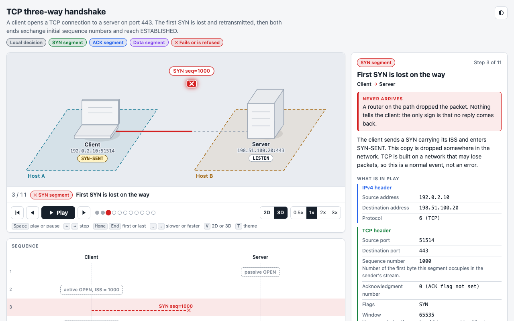
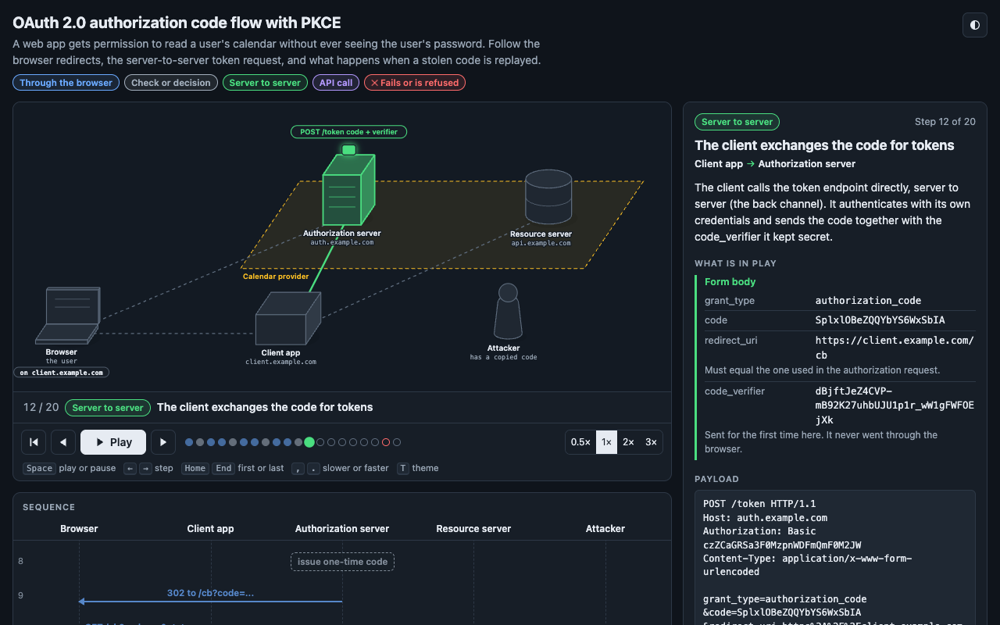
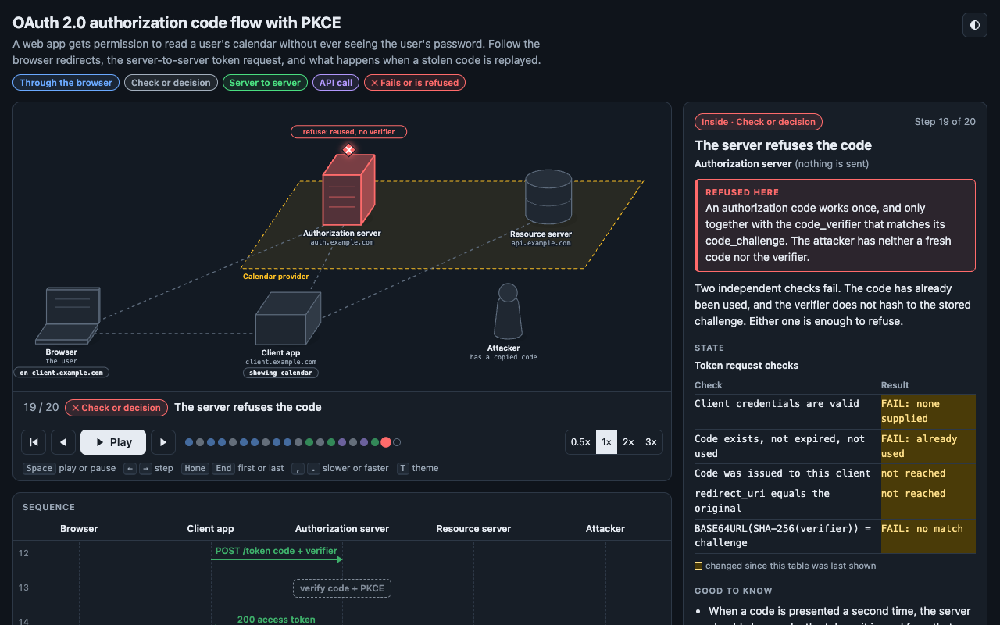
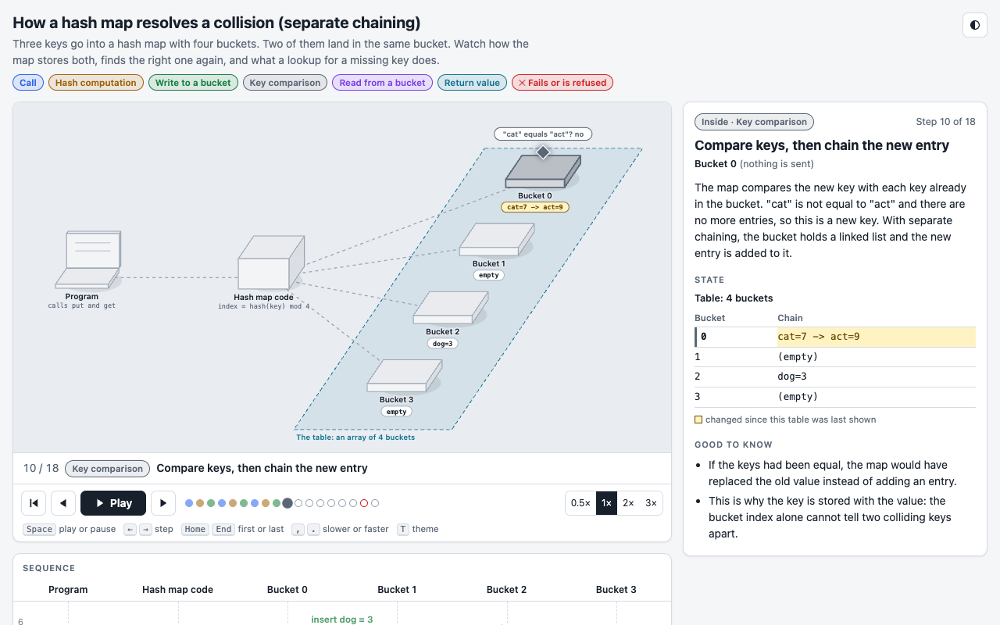
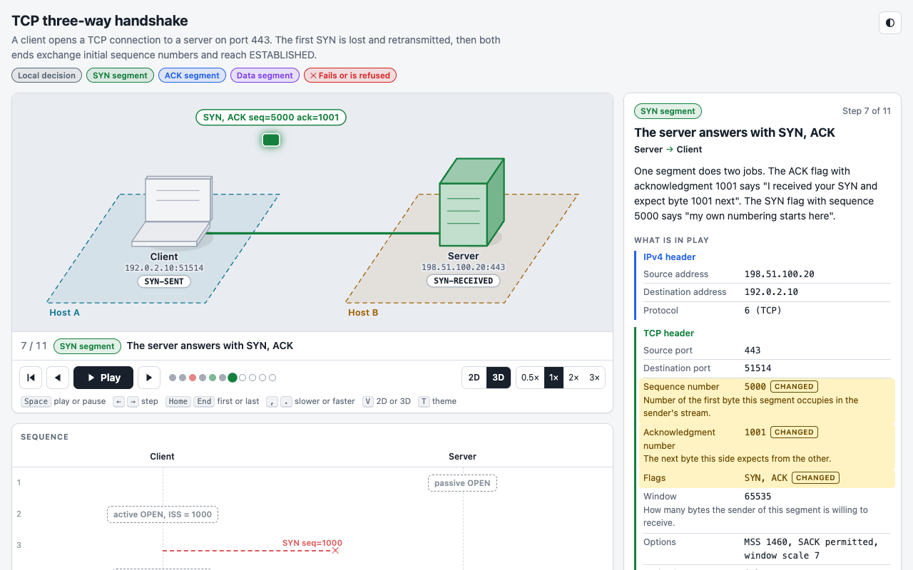
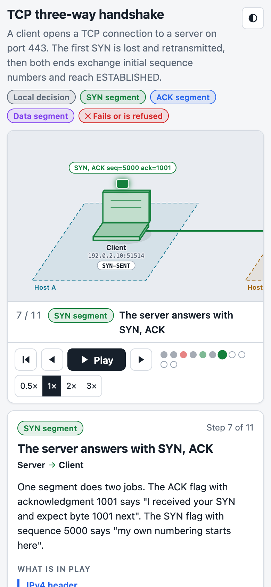
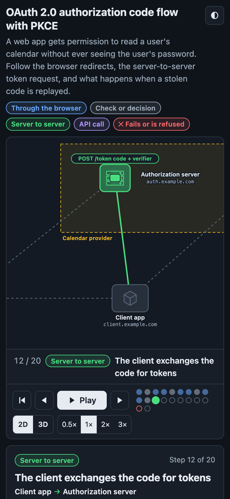

# visualize-anything

[](https://ko-fi.com/P6G12AH04U)

An agent skill that turns any process, protocol, architecture or algorithm into an interactive, step-by-step visual explainer.

You ask your coding agent something like "visualize how the TCP handshake works". The agent researches the subject, writes it down as data (who takes part, and what happens one step at a time), and builds a single HTML file you can open in any browser: a scene, a token that moves between the parts, a sequence timeline, and an inspector that shows exactly what is in play at each step and what changed.



Works with Claude (Claude Code and the Claude apps), GitHub Copilot and OpenAI Codex. The skill follows the open [Agent Skills](https://agentskills.io/specification) format, so other agents that read that format can use it too.

## The idea

**The subject is written as data, and a fixed player renders it.**

The agent does not write a renderer, an animation loop or any CSS. Those ship with the skill as one dependency-free file, [`player.html`](skills/visualize-anything/assets/player.html). The agent's work is the part that matters: understanding the subject, getting the facts right, and cutting it into steps that teach. It writes a JSON spec, runs a validator, and runs a build script that embeds the spec into the player.

> **See the method at full size: [network-graph-sigma.vercel.app](https://network-graph-sigma.vercel.app)** (Network Graph, the live reference project). Start with the [GCP Lab Explorer](https://network-graph-sigma.vercel.app/gcp): three load-balancer labs played one packet at a time.

This method comes from [Network Graph](https://network-graph-sigma.vercel.app), where fourteen networking lessons (NAT, ARP, DHCP, DNS, TCP, load balancers and more) are written as data and one player renders them all. Network Graph is the reference project and the worked example of the method at full size. This skill is the method on its own, with a smaller player that needs no build step.

## Examples

Three subjects, chosen to be different from each other. Each link is the built file; download it and open it, or clone the repository and open it from `examples/`.

| Example | Subject | Spec | Built |
| --- | --- | --- | --- |
| TCP three-way handshake | A network protocol. Two hosts, a lost SYN and its retransmission, connection state on both sides. | [json](skills/visualize-anything/examples/tcp-handshake.json) | [html](examples/tcp-handshake.html) |
| OAuth 2.0 authorization code flow with PKCE | A security protocol with five parties, HTTP payloads, and a replayed code that is refused. | [json](skills/visualize-anything/examples/oauth-authorization-code.json) | [html](examples/oauth-authorization-code.html) |
| Hash map collision | A data structure. Two keys land in one bucket; a lookup for a missing key fails. | [json](skills/visualize-anything/examples/hash-map-collision.json) | [html](examples/hash-map-collision.html) |

| | |
| --- | --- |
|  |  |
|  |  |

On a phone the scene scrolls and follows the token:

<p>


</p>

The screenshots were taken from the built examples in headless Chrome.

## What an explainer contains

- A 2.5D scene of actors (drawn as simple solids), zones and links.
- One token per step. It travels between two actors, or pulses above one actor for a decision or lookup that happens inside it.
- Failure steps drawn differently: the token stops part-way, turns red and is crossed out, and the reason is shown.
- A status chip under each actor for state that persists (a connection state, the contents of a slot).
- A sequence timeline of every step. Click a row to jump to it.
- An inspector: title, description, field tables with rewritten fields highlighted, a raw payload, state tables in which cells that changed since the table was last shown are highlighted, and notes.
- Play, pause, step, restart, four speeds. Keyboard: `Space` play or pause, `←` `→` step, `Home` `End` first or last, `,` `.` slower or faster, `T` theme.
- Light and dark themes that follow the system setting. A layout that works down to 390 px wide.
- A closing panel that lists what the model leaves out and the sources it was built from.
- One HTML file of about 50 kB. No network requests, no dependencies, no server.

## Install

The skill is the directory [`skills/visualize-anything/`](skills/visualize-anything/). Installing it means putting that directory where your agent looks for skills. The scripts need Node.js 18 or later; nothing else.

What was and was not confirmed for each product is listed under [Compatibility notes](#compatibility-notes).

### Claude Code

As a plugin, from inside Claude Code:

```
/plugin marketplace add otistruong/visualize-anything
/plugin install visualize-anything@visualize-anything
```

Or from a shell:

```bash
claude plugin marketplace add otistruong/visualize-anything
claude plugin install visualize-anything@visualize-anything
```

Or without the plugin system, as a personal skill:

```bash
git clone https://github.com/otistruong/visualize-anything
cp -R visualize-anything/skills/visualize-anything ~/.claude/skills/
```

For one project only, copy it to `.claude/skills/visualize-anything/` in that project instead.

### Claude apps (claude.ai and desktop)

Zip the skill directory so that the folder itself is at the top of the archive, then upload it under Customize > Skills (code execution must be turned on).

```bash
git clone https://github.com/otistruong/visualize-anything
cd visualize-anything/skills && zip -r visualize-anything.zip visualize-anything
```

### GitHub Copilot

With the GitHub CLI (version 2.90 or later; `gh skill` is in preview):

```bash
gh skill install otistruong/visualize-anything visualize-anything --agent github-copilot --scope user
```

Use `--scope project` to install into the current repository instead. In Copilot CLI you can also install the repository as a plugin:

```
/plugin install otistruong/visualize-anything
```

Or copy the directory by hand to `.github/skills/visualize-anything/` in a repository (also read: `.claude/skills/`, `.agents/skills/`) or to `~/.copilot/skills/visualize-anything/` for all your work.

### OpenAI Codex

```bash
gh skill install otistruong/visualize-anything visualize-anything --agent codex --scope user
```

Or copy the directory by hand to `.agents/skills/visualize-anything/` in a repository, or to `~/.agents/skills/visualize-anything/` for all your work. In Codex, invoke it with `$visualize-anything` or let Codex pick it up from the request.

### Agents without skill support

If an agent reads `AGENTS.md` or custom instructions but not skills, copy the skill into the project at `.agents/skills/visualize-anything/` and paste [`adapters/AGENTS.snippet.md`](adapters/AGENTS.snippet.md) into the project's `AGENTS.md` (or `.github/copilot-instructions.md`). For VS Code, [`adapters/copilot/visualize-anything.prompt.md`](adapters/copilot/visualize-anything.prompt.md) can be copied to `.github/prompts/` to get a `/visualize-anything` command. Both are short pointers to the skill, not copies of it.

## Quick start

After installing, ask for an explainer in your own words:

> Visualize how the TCP three-way handshake works, step by step.

> Make an interactive explainer of what happens when a Kubernetes Pod is scheduled.

> Explain visually how a B-tree insert splits a node.

The agent will write `<subject>.json` and `<subject>.html` in your working directory and finish with a list of what it simplified and the sources it used. Open the HTML file in a browser.

To do it by hand, without an agent:

```bash
cd skills/visualize-anything
node scripts/validate.mjs examples/tcp-handshake.json
node scripts/build.mjs examples/tcp-handshake.json /tmp/tcp-handshake.html
```

The format is in [`references/spec.md`](skills/visualize-anything/references/spec.md) and the method in [`references/method.md`](skills/visualize-anything/references/method.md).

## Repository layout

```
skills/visualize-anything/     the skill: the only source of truth
  SKILL.md                     workflow the agent follows
  references/spec.md           the spec format, field by field
  references/method.md         how to model a subject so that it teaches
  assets/player.html           the player: one file, no dependencies
  scripts/validate.mjs         checks a spec, with messages that say how to fix it
  scripts/build.mjs            embeds a spec into the player
  examples/*.json              three complete specs
examples/*.html                the three examples, built
.claude-plugin/                Claude Code plugin and marketplace manifests   (generated)
plugin.json                    portable plugin manifest                      (generated)
adapters/                      pointer files for AGENTS.md and Copilot prompts (generated)
evals/                         prompts, cases and a runner for testing the skill
scripts/                       sync.mjs, build-examples.mjs, check-docs.mjs
docs/screenshots/              the images in this README
```

### One source, thin adapters

There is one copy of the skill. Claude, Copilot and Codex all read the same `SKILL.md` format, so the skill directory is used as it is by all three and nothing is translated per agent.

What differs between products is packaging, and that is generated. [`scripts/sync.mjs`](scripts/sync.mjs) reads the name and description from `SKILL.md` and the version from `package.json`, and writes the plugin manifests and the two pointer files. The generated files are committed so that installing from GitHub works without running anything, and CI fails if they are out of date. Symlinks were avoided because they break on Windows checkouts and in zip uploads.

`SKILL.md` uses only the frontmatter keys every target accepts (`name`, `description`, `license`), and `sync.mjs` rejects any other key.

## Testing the skill

```bash
npm test
```

This validates the examples, checks that the built HTML and the adapters are up to date, and runs the offline evals. It installs nothing.

The evals answer two questions: does the agent pick the skill up for the right requests, and does it follow the workflow when it does?

- [`evals/triggers.json`](evals/triggers.json): prompts that should and should not activate the skill, each with the reason.
- [`evals/cases.json`](evals/cases.json): task prompts with the behaviour expected, as assertions a script can check ("validates before building", "at least one failure step with a reason", "final message lists sources").
- [`evals/run.mjs`](evals/run.mjs): checks a directory of agent output against a case (offline), or, with `--live`, runs a case in a temporary directory with an installed agent CLI, records what the agent did, and checks that.

```bash
node evals/run.mjs                                    # offline, against the bundled fixtures
node evals/run.mjs --case tcp-handshake --dir <dir>   # offline, against your own agent output
node evals/run.mjs --live --case dns-resolution       # live; uses your agent CLI and your model usage
```

Live mode never runs unless you pass `--live`. See [evals/README.md](evals/README.md) for how to read the output and how to add a case.

## Compatibility notes

Checked against each product's documentation on 2026-11-11. Products change; if something here is out of date, please open an issue.

**Claude Code.** Skills are read from `~/.claude/skills/<name>/SKILL.md`, `.claude/skills/<name>/SKILL.md` and a plugin's `skills/` directory ([skills documentation](https://code.claude.com/docs/en/skills)). A repository becomes installable through `.claude-plugin/plugin.json` and `.claude-plugin/marketplace.json` ([plugins reference](https://code.claude.com/docs/en/plugins-reference), [marketplaces](https://code.claude.com/docs/en/plugin-marketplaces)). Both manifests in this repository pass `claude plugin validate` (Claude Code 2.1), and one eval case was run end to end with the skill installed as a project skill. Installing from the GitHub marketplace could not be tested before the repository was public.

**Claude apps.** Custom skills are uploaded as a ZIP with the skill folder at the top ([using skills](https://support.claude.com/en/articles/12512180-use-skills-in-claude), [creating custom skills](https://support.claude.com/en/articles/12512198-how-to-create-custom-skills)). Not confirmed: that help article gives a 200 character limit for the description, while the Agent Skills specification allows 1024 and this skill's description is about 880; if the upload is refused for that reason, shorten the description in your copy. Also not confirmed: whether Node.js is available in the apps' code execution environment. If it is not, `SKILL.md` tells the agent to embed the spec into the player by hand.

**GitHub Copilot.** Agent Skills are supported by Copilot CLI, the cloud agent and agent mode in the IDEs. Project skills are read from `.github/skills`, `.claude/skills` and `.agents/skills`; personal skills from `~/.copilot/skills` and `~/.agents/skills` ([about agent skills](https://docs.github.com/en/copilot/concepts/customizations/agent-skills)). `gh skill install` and the Copilot CLI plugin commands are documented in the [GitHub CLI manual](https://cli.github.com/manual/gh_skill_install) and the [Copilot CLI plugin reference](https://docs.github.com/en/copilot/reference/copilot-cli-reference/cli-plugin-reference). Tested here: `gh skill install --from-local` places the skill correctly for `github-copilot`, `codex` and `claude-code`, and `gh skill publish --dry-run` accepts the repository. Not tested: installing as a Copilot CLI plugin, and a full run in Copilot. Prompt files (`.github/prompts/*.prompt.md`) are a [VS Code feature](https://code.visualstudio.com/docs/agent-customization/prompt-files); the generated prompt file was written from that documentation and not run.

**OpenAI Codex.** Codex reads skills from `.agents/skills` in the working directory and its parents up to the repository root, and from `~/.agents/skills` ([skills documentation](https://learn.chatgpt.com/docs/build-skills)). Codex was not installed where this was built, so nothing was run in it. The root `plugin.json` follows the portable manifest described in the [Codex plugin documentation](https://developers.openai.com/plugins/build/plugins); installing this repository as a Codex plugin is untested, and the shape of a marketplace entry for a plugin at the repository root could not be confirmed, so no Codex marketplace file is shipped. Use the skill directory routes above.

**Other installers.** `npx skills add otistruong/visualize-anything` (the third-party [skills](https://github.com/vercel-labs/skills) installer) should find the skill in `skills/`. Not tested.

## Limitations

- The explainer is a teaching model, not an emulator. Nothing is computed: every value on screen was written into the spec.
- One linear sequence per explainer. No branching by viewer choice, no loops, no parallel tokens. A "what if" case is modelled as extra steps at the end.
- The scene is 2.5D with eight fixed shapes. There are no custom icons and no free camera.
- About nine actors and twenty-six steps is the practical ceiling. Larger subjects should be split.
- Accuracy depends on the agent and on the sources it could reach. The validator checks structure, layout and the presence of sources and a failure case. It cannot check facts.
- Layout is chosen by the agent using coordinates. The validator catches overlapping actors and colliding labels, but a scene can still be legible and ugly.
- The player needs a browser from about 2023 or later (it uses the CSS `color-mix()` function).
- Text is English, left to right. The player's own labels are not translatable yet.

## Disclaimer

The skill and the explainers it produces are for education. Explainers can contain mistakes and always simplify; check them against primary sources before relying on them. Nothing here is professional advice. This is an independent project, not affiliated with or endorsed by any company whose products or protocols are named. Provided "as is" with no warranty. The full text is in [DISCLAIMER.md](DISCLAIMER.md).

## Contributing and contact

See [CONTRIBUTING.md](CONTRIBUTING.md). For questions, bugs and corrections, open an issue at <https://github.com/otistruong/visualize-anything/issues>.

## Support

If this skill is useful to you, you can support the work on Ko-fi.

[](https://ko-fi.com/P6G12AH04U)

## Licence

MIT, © 2026 Otis. See [LICENSE](LICENSE) and [DISCLAIMER.md](DISCLAIMER.md).
